# 🔐 Portal de Acesso Seguro & Enterprise Auth (v2.0)

<p align="center">
  
  
  
  
  
  
</p>

---

## 🌐 Idioma / Language
* 🇧🇷 [Português](#-documenta%C3%A7%C3%A3o-em-portugu%C3%AAs)
* 🇺🇸 [English Documentation](#-english-documentation)

---

# 🇧🇷 Documentação em Português

## 🌟 Visão Geral do Projeto

O **Portal de Acesso Seguro & Enterprise Auth v2.0** é uma plataforma web cliente-servidor de alta fidelidade para autenticação, cadastro e governança de acessos corporativos. Projetado com padrões de tolerância a falhas, conformidade de segurança e experiência visual imersiva, o sistema reúne validações matemáticas estritas de documentos brasileiros, criptografia ponta a ponta no navegador, telemetria analítica com HTML5 Canvas e resiliência offline completa via Progressive Web App (PWA).

### 🎯 Principais Destaques
1. **Motor de Segurança Multi-Camadas**: Validação matemática módulo 11 de CPF e CNPJ, cálculo de entropia de Shannon para senhas, mitigação de ataques de dicionário, detecção de credenciais vazadas e bloqueio contra força bruta com *exponential backoff*.
2. **Criptografia Web Cryptography API**: Hashing nativo SHA-256 com sal criptográfico dinâmico por usuário e sessões autenticadas via tokens estruturados JWT (Header.Payload.Signature).
3. **PWA Enterprise (`access-portal-v2`)**: Service Worker com estratégia híbrida (Cache-First para ativos estáticos, Network-First para navegações HTML), pré-carregamento tolerante e fallback offline.
4. **Resolução de Endereço em Cascata**: Consulta automática com *debouncing* (350ms) integrando **BrasilAPI → ViaCEP → Cache em Memória**.
5. **Painel Analítico em Canvas Puro**: Gráfico de frequência de acessos (splines cúbicas de Bézier), Gráfico Donut de pontuação de conformidade e Velocímetro Radial com alternância de métricas de CPU, Memória e Latência.
6. **Suíte Interativa de 57 Testes Unitários**: Test Runner nativo no navegador sem dependência de Node.js, com 100% de taxa de sucesso e cobertura de 11 módulos de arquitetura.

---

## 🏛️ Diagrama de Arquitetura do Sistema

```mermaid
flowchart TD
    subgraph UI["Camada de Interface (UI & Glassmorphism)"]
        Index["index.html (Abas Login & Registro)"]
        Dash["dashboard.html (Painel Analítico)"]
        Tests["tests/index.html (Test Runner)"]
        Goku["goku.html (Easter Egg Clássico)"]
    end

    subgraph Theme["Motor de Temas"]
        Engine["theme-engine.js"]
        Dark["Executive Dark"]
        Saiyan["Super Saiyan Mode (Aura & Partículas)"]
        Engine --> Dark
        Engine --> Saiyan
    end

    subgraph Security["Camada de Segurança & Validação"]
        Val["validators.js (CPF, CNPJ, Telefone, CEP, E-mail)"]
        Sec["security.js (Entropia Shannon, Sanitização XSS, Rate Limiter)"]
        Dict["Dicionário Top 100 & Leetspeak Defense"]
        BF["Brute-Force Lockout & Exponential Backoff"]
    end

    subgraph BackendMock["Backend Simulado & Sessão"]
        Auth["auth-service.js (Intercepção Axios)"]
        CryptoSubtle["Web Crypto API (SHA-256 + Salt)"]
        JWT["Emissor & Validador de Tokens JWT"]
        LocalStore[("localStorage / sessionStorage")]
    end

    subgraph Integrations["Integrações Externas & PWA"]
        CepService["cep-service.js (BrasilAPI -> ViaCEP -> Cache)"]
        SW["sw.js (access-portal-v2 & Offline Engine)"]
        Manifest["manifest.json (PWA 2.0 Spec)"]
    end

    subgraph Telemetry["Telemetria, Gráficos & Exportação"]
        Charts["dashboard-charts.js (Canvas Splines, Donut, Gauge)"]
        Exports["export-service.js (JSON, CSV, SVG QR Code, Print)"]
    end

    Index --> Val
    Index --> Sec
    Index --> Auth
    Index --> CepService
    Auth --> CryptoSubtle
    Auth --> JWT
    Auth --> LocalStore
    Sec --> BF
    Sec --> Dict
    Dash --> Charts
    Dash --> Exports
    UI --> Theme
    UI --> SW
```



---

## 🎨 Arquitetura de Temas Dupla (Dual-Theme Engine)

O sistema conta com dois temas altamente refinados gerenciados por [`js/theme-engine.js`](js/theme-engine.js):

| Tema | Características Visuais | Paleta Primária | Persistência |
| :--- | :--- | :--- | :--- |
| **Executive Dark** | Design corporativo sóbrio, glassmorphism com desfoque de fundo (`backdrop-filter: blur`), tipografia de precisão e acentos azul neon. | Fundo: `#0B0F19`<br>Superfície: `#1E293B`<br>Acento: `#3B82F6` | `localStorage: portal_theme = 'default'` |
| **Super Saiyan Mode** | Efeito Dragon Ball temático com partículas de Ki em CSS puro, bordas douradas pulsantes, tipografia estilizada e iluminação dourada e azul. | Fundo: `#000000`<br>Partículas: `#FFD700`<br>Aura: `#FF0043` & `#FFA500` | `localStorage: portal_theme = 'saiyan'` |

* **Troca Instantânea**: Alternância suave sem necessidade de recarregar a página.
* **Auto-Detecção de Preferência de Sistema**: Sincronização automática com `prefers-color-scheme`.

---

## 🛡️ Camadas de Segurança & Defesa Contra Ameaças

### 1. Validação Estrita de Documentos Brasileiros (Módulo 11)
Implementada em [`js/validators.js`](js/validators.js):
* **CPF (Cadastro de Pessoas Físicas)**:
  * Algoritmo formal da Receita Federal com cálculo ponderado dos dois dígitos verificadores:
    $$\text{Resto}_1 = \left(\sum_{i=1}^{9} d_i \times (10 - i + 1)\right) \times 10 \pmod{11}$$
    $$\text{Resto}_2 = \left(\sum_{i=1}^{10} d_i \times (11 - i + 1)\right) \times 10 \pmod{11}$$
  * Rejeição obrigatória das 10 sequências com dígitos repetidos (`000.000.000-00` até `999.999.999-99`).
* **CNPJ (Cadastro Nacional de Pessoas Jurídicas)**:
  * Cálculo ponderado com fatores circulares $5, 4, 3, 2, 9, 8, 7, 6, 5, 4, 3, 2$ para o primeiro dígito e $6, 5, 4, 3, 2, 9, 8, 7, 6, 5, 4, 3, 2$ para o segundo dígito.
  * Rejeição de sequências com 14 dígitos idênticos.
  * Validação aprovada com CNPJs canônicos (ex: Banco do Brasil `00.000.000/0001-91` e Petrobras `33.000.167/0001-01`).

### 2. Entropia de Senhas & Defesa de Dicionário
Implementada em [`js/security.js`](js/security.js):
* **Entropia da Teoria da Informação (Shannon)**:
  $$H = -\sum_{i=1}^{N} p(x_i) \log_2 p(x_i)$$
* **Espaço de Chaves (Keyspace Entropy Bits)**:
  $$\text{Bits} = L \times \log_2(R)$$
  Onde $L$ é o comprimento e $R$ é a cardinalidade do conjunto de caracteres (minúsculas: 26, maiúsculas: 26, dígitos: 10, símbolos: 33).
* **Bloqueio contra Ataque de Dicionário**:
  * Lista com mais de 100 termos vazados comuns (`123456`, `password`, `admin`, `dragonball`, `kakaroto`, etc.).
  * Normalização leetspeak automática (ex: `P@ssw0rd` $\rightarrow$ `password`, `4dm1n` $\rightarrow$ `admin`).
  * Penalização severa de pontuação caso a senha contenha termos vulneráveis.

### 3. Criptografia Nativa com Web Crypto API (`crypto.subtle`)
Implementada em [`js/auth-service.js`](js/auth-service.js):
* Geração de hash unidirecional criptográfico de 256 bits (64 caracteres hexadecimais).
* Sal criptográfico randômico dinâmico por usuário (`crypto.getRandomValues`) evitando ataques com *Rainbow Tables*.
* Compatibilidade com sal estático legado de transição.
* Propriedade de Efeito Avalanche comprovada (alteração de 1 bit na entrada altera mais de 40% dos bits do hash).

### 4. Gestão de Sessão JWT (JSON Web Tokens)
* Emissão de token estruturado em 3 blocos Base64URL separados por ponto:
  $$\text{JWT} = \text{Header}.\text{Payload}.\text{Signature}$$
* **Header**: `{"alg": "HS256", "typ": "JWT"}`.
* **Payload**: Contém identificador de usuário (`sub`), e-mail (`email`), documento (`cpf`), timestamp de emissão (`iat`) e timestamp de expiração (`exp`).
* Métodos de decodificação (`decodeJwtToken`), verificação (`verifyJwtToken`) e auditoria de expiração (`isTokenExpired`).

### 5. Sanitização Estrita contra Cross-Site Scripting (XSS)
* Remoção integral de tags executáveis perigosas (`<script>`, `<iframe>`, `<style>`, `<object>`, `<embed>`).
* Purga de todos os manipuladores de eventos em atributos HTML (`onerror`, `onload`, `onclick`, etc.).
* Bloqueio de pseudo-protocolos perigosos (`javascript:`, `vbscript:`, `data:`).

### 6. Mitigação de Força Bruta com Backoff Exponencial
* **Limiar de Bloqueio**: 5 tentativas falhadas consecutivas acionam um bloqueio (*lockout*) de 15 minutos (900.000ms).
* **Backoff Exponencial Escalonado**: Intervalos progressivos de espera calculados geometricamente a cada reincidência ($30\text{s} \times 2^{\text{tier}-1}$).
* Persistência em `localStorage` com restauração automática após expiração do tempo ou login com sucesso.

---

## 📡 Integrações de API & Mocks Resilientes

### Resolução de CEP em Três Níveis
No arquivo [`js/cep-service.js`](js/cep-service.js):
1. **1º Nível (BrasilAPI)**: Requisição primária para `https://brasilapi.com.br/api/cep/v1/{cep}`.
2. **2º Nível (ViaCEP - Failover)**: Em caso de falha de conexão ou timeout, redirecionamento imediato para `https://viacep.com.br/ws/{cep}/json/`.
3. **3º Nível (Cache em Memória)**: Respostas bem-sucedidas são gravadas em `Map`, permitindo consultas instantâneas repetidas (`fromCache: true`) e funcionamento offline.
4. **Debouncing Automático**: Disparo da requisição somente após 350ms sem novas digitações, evitando requisições desnecessárias.

---

## 📱 Progressive Web App (PWA) & Resiliência Offline

* **Manifesto PWA 2.0 ([`manifest.json`](manifest.json))**:
  * Especificação moderna com `id`, `start_url`, `theme_color`, ícones 192x192 e 512x512 com suporte `any maskable`.
  * Atalhos de aplicativo (*App Shortcuts*) para Login, Dashboard e Test Runner.
* **Service Worker (`access-portal-v2`) em [`js/sw.js`](js/sw.js) e [`sw.js`](sw.js)**:
  * **Estratégia Cache-First**: Para arquivos CSS, JS, fontes, imagens e recursos CDN.
  * **Estratégia Network-First**: Para navegações HTML, garantindo dados sempre frescos quando online com fallback transparente quando offline.
  * **Limpeza Ativa**: Purga automática de versões obsoletas (`portal-acesso-v1`) no evento `activate`.

---

## 📊 Painel Analítico & Dashboard (Canvas Puro)

Desenvolvido em [`js/dashboard-charts.js`](js/dashboard-charts.js) com renderização em HTML5 Canvas nativo:
1. **Gráfico de Área & Linha de Acessos**:
   * Curvas suaves com splines cúbicas de Bézier.
   * Gradientes neon multi-parada com brilho volumétrico (*glow*).
   * Mira (*crosshair*) e *tooltip* flutuante em tempo real no evento `mousemove`.
2. **Gráfico Donut de Conformidade de Segurança**:
   * 4 pilares: Web Crypto API (30%), Autenticação TOTP 2FA (25%), Política de Senhas (25%) e Integridade de Sessão (20%).
   * Destaque interativo com expansão da fatia selecionada.
3. **Velocímetro / Gauge Radial de Saúde do Cluster**:
   * Setores dinâmicos (Verde: Normal, Amarelo: Atenção, Vermelho: Crítico).
   * Física amortecida de agulha e alternador dinâmico de métricas (CPU, Memória, Latência).
4. **Gerador Vetorial de QR Code 2FA em SVG ([`js/export-service.js`](js/export-service.js))**:
   * Geração de QR Code TOTP padrão RFC 6238 sem bibliotecas externas.
5. **Serviço de Exportação Multi-Formato**:
   * Relatório de Auditoria Estruturado em JSON (`auditoria_sessao.json`).
   * Trilha de Auditoria em CSV com codificação UTF-8 BOM para Microsoft Excel.
   * Relatório Executivo Impresso para PDF via `@media print`.

---

## 🧪 Bateria de Testes Automatizados (57 Asserções)

O projeto possui um **Test Runner Interativo Nativo** em [`tests/index.html`](tests/index.html) e [`tests/unit-tests.js`](tests/unit-tests.js):

| Módulo / Domínio de Teste | Quantidade | Status | Destaques de Cobertura |
| :--- | :---: | :---: | :--- |
| **Documentos BR (CPF / CNPJ)** | 7 | ✅ 100% | CPFs válidos conhecidos, 10 sequências repetidas, dígitos corrompidos, CNPJs válidos (BB/Petrobras), sequências repetidas de CNPJ. |
| **Máscaras de Entrada BR** | 4 | ✅ 100% | Máscara de CPF (`000.000.000-00`), CNPJ (`00.000.000/0001-00`), Celular/Fixo, CEP. |
| **CEP & Endereço (ViaCEP)** | 4 | ✅ 100% | Formato estrito de 8 dígitos, normalização de payload, tratamento de erro (`erro: true`), cache em memória (`fromCache: true`). |
| **Conformidade E-mail (RFC 5322)** | 3 | ✅ 100% | Domínios corporativos, subendereçamento (`+tag`), rejeição de malformados (espaços, pontos duplos). |
| **Entropia de Senha** | 3 | ✅ 100% | Penalização de senhas curtas, pontuação forte (>= 80%), requisitos granulares. |
| **Ataque de Dicionário** | 3 | ✅ 100% | Termos vazados comuns, leetspeak (`P@ssw0rd`), penalidade severa de pontuação. |
| **Web Crypto API (SHA-256)** | 3 | ✅ 100% | Hashing determinístico, 64 caracteres hexadecimais, Efeito Avalanche (>40% variação de bits). |
| **Sessão JWT** | 4 | ✅ 100% | Formato 3 blocos (Header.Payload.Signature), cabeçalho HS256, claims (`sub, email, cpf, exp`), expiração de token. |
| **Segurança & XSS** | 3 | ✅ 100% | Remoção integral de `<script>`, purga de handlers de evento (`onerror`), bloqueio de `javascript:`. |
| **Brute-Force & Backoff** | 4 | ✅ 100% | Contagem de falhas, bloqueio na 5ª tentativa, backoff exponencial geométrico ($30\text{s} \times 2^{n-1}$), reset pós-sucesso. |
| **Dashboard Canvas Analytics** | 6 | ✅ 100% | Instanciação de gráficos, histórico de 7 dias, soma Donut 100%, setores do Gauge, alternância de métrica, renderAll e resize. |
| **Recuperação de Conta & Exportações** | 13 | ✅ 100% | Busca por CPF/Email, token de 6 dígitos, expiração de token, exportação JSON, CSV com BOM, SVG QR Code puro e impressão. |
| **TOTAL** | **57** | **✅ 100%** | **57 de 57 Testes Automatizados Aprovados com Sucesso.** |

---

## 📂 Estrutura de Arquivos

```text
Tela-de-acesso-site/
├── index.html                  # Portal principal com abas de login, registro e recuperação
├── dashboard.html              # Painel corporativo pós-autenticação com gráficos e métricas
├── goku.html                   # Modo temático Dragon Ball clássico
├── manifest.json               # Manifesto PWA 2.0 com suporte offline e atalhos
├── sw.js                       # Service Worker v2 na raiz do repositório
├── vegeta.css                  # Estilos globais Dark Glassmorphism
├── script.js                   # Controlador da interface principal
├── styles/
│   ├── vegeta.css              # Cópia modularizada da folha de estilos
│   └── particles.css           # Sistema de partículas cósmicas e aura em CSS puro
├── js/
│   ├── auth-service.js         # Backend simulado, Web Crypto SHA-256 e emissão de JWT
│   ├── cep-service.js          # Resolução de endereço em cascata (BrasilAPI -> ViaCEP -> Cache)
│   ├── dashboard.js            # Lógica de proteção de rotas, sessão e logout do dashboard
│   ├── dashboard-charts.js     # Motor analítico em HTML5 Canvas puro (Linha, Donut, Gauge)
│   ├── export-service.js       # Exportador multi-formato (JSON, CSV BOM, SVG QR Code, Print)
│   ├── notifications.js        # Wrapper SweetAlert2 e toasts leves
│   ├── password-recovery.js    # Fluxo completo de recuperação de senha por token
│   ├── security.js             # Entropia Shannon, mitigação de dicionário, sanitização XSS e lockout
│   ├── sw.js                   # Service Worker v2 (access-portal-v2)
│   ├── theme-engine.js         # Gerenciador dinâmico de temas (Executive Dark vs Super Saiyan)
│   └── validators.js           # Algoritmos módulo 11 de CPF/CNPJ, máscaras e validação RFC 5322
├── tests/
│   ├── index.html              # Runner interativo visual no navegador com filtros e busca
│   └── unit-tests.js           # Bateria de 57 asserções automatizadas
└── .github/
    └── workflows/
        └── ci.yml              # Pipeline de Integração Contínua (CI) e deploy no GitHub Pages
```

---

## 🚀 Como Executar Localmente

1. **Acesso Direto no Navegador**:
   * Abra o arquivo `index.html` em qualquer navegador web moderno.
2. **Executar a Bateria de Testes**:
   * Abra `tests/index.html` no navegador. O test runner executará automaticamente as 57 asserções em tempo real.
3. **Servidor HTTP Local (Opcional para Service Worker)**:
   ```bash
   # Utilizando Python 3
   python -m http.server 8080
   
   # Ou utilizando Node.js http-server
   npx http-server -p 8080
   ```
   Acesse: `http://localhost:8080`

---
---

# 🇺🇸 English Documentation

## 🌟 Project Overview

**Secure Access Portal & Enterprise Auth v2.0** is an enterprise-grade client-side application for user authentication, registration, and access governance. Engineered with fault-tolerant principles, strict Brazilian compliance regulations, and immersive glassmorphic design, it features mathematical checksum validation, native in-browser Web Cryptography, HTML5 Canvas telemetry, and full offline resilience powered by Progressive Web App (PWA) technologies.

### 🎯 Core Highlights
1. **Multi-Tier Security Architecture**: Strict Modulo 11 validation for Brazilian CPF and CNPJ documents, Shannon information entropy scoring for passwords, leaked password dictionary blacklist, leetspeak defense, and brute-force lockout with geometric exponential backoff.
2. **Web Cryptography API Engine**: Native SHA-256 cryptographic hashing with randomized dynamic salt per user and authenticated sessions managed via structured JWT tokens (Header.Payload.Signature).
3. **Enterprise PWA (`access-portal-v2`)**: Service Worker using a hybrid caching strategy (Cache-First for static assets, Network-First for HTML navigation), fault-tolerant pre-caching, and offline fallback responses.
4. **Cascading Address Resolution**: Instant automatic address completion with a 350ms debounce integrating **BrasilAPI → ViaCEP → In-Memory Cache**.
5. **Pure Canvas Telemetry**: 7-day access frequency graph (cubic Bezier splines), Donut compliance chart, and multi-metric Radial Speedometer Gauge (CPU, Memory, Latency).
6. **57 Automated Unit Tests Suite**: Browser-native test runner without Node.js runtime requirement, achieving a 100% pass rate across 11 architectural domains.

---

## 🏛️ System Architecture Diagram

```mermaid
flowchart TD
    subgraph UI["User Interface Layer"]
        Index["index.html (Login & Register Tabs)"]
        Dash["dashboard.html (Analytics Dashboard)"]
        Tests["tests/index.html (Unit Test Runner)"]
        Goku["goku.html (Classic Dragon Ball Theme)"]
    end

    subgraph ThemeEngine["Theme Engine"]
        Engine["theme-engine.js"]
        Dark["Executive Dark"]
        Saiyan["Super Saiyan Mode (Ki Aura & Particles)"]
        Engine --> Dark
        Engine --> Saiyan
    end

    subgraph SecurityLayer["Security & Validation Layer"]
        Val["validators.js (CPF, CNPJ, Phone, CEP, Email)"]
        Sec["security.js (Shannon Entropy, XSS Sanitizer, Rate Limiter)"]
        Dict["Top 100 Dictionary & Leetspeak Defense"]
        BF["Brute-Force Lockout & Exponential Backoff"]
    end

    subgraph BackendMock["Mock Backend & Session Management"]
        Auth["auth-service.js (Axios Interception)"]
        CryptoSubtle["Web Crypto API (SHA-256 + Salt)"]
        JWT["JWT Issuer & Expiration Verifier"]
        LocalStore[("localStorage / sessionStorage")]
    end

    subgraph Integrations["External Services & PWA"]
        CepService["cep-service.js (BrasilAPI -> ViaCEP -> Memory Cache)"]
        SW["sw.js (access-portal-v2 & Offline Engine)"]
        Manifest["manifest.json (PWA 2.0 Spec)"]
    end

    subgraph Telemetry["Canvas Visualizations & Reports"]
        Charts["dashboard-charts.js (Splines, Donut, Radial Gauge)"]
        Exports["export-service.js (JSON, CSV BOM, SVG QR Code, Print)"]
    end

    Index --> Val
    Index --> Sec
    Index --> Auth
    Index --> CepService
    Auth --> CryptoSubtle
    Auth --> JWT
    Auth --> LocalStore
    Sec --> BF
    Sec --> Dict
    Dash --> Charts
    Dash --> Exports
    UI --> ThemeEngine
    UI --> SW
```



---

## 🎨 Dual-Theme Architecture

Managed seamlessly by [`js/theme-engine.js`](js/theme-engine.js):

| Theme | Visual Aesthetics | Primary Palette | Storage Persistence |
| :--- | :--- | :--- | :--- |
| **Executive Dark** | Corporate slate aesthetic, high-blur glassmorphism (`backdrop-filter: blur`), precision typography, and neon blue accents. | Background: `#0B0F19`<br>Surface: `#1E293B`<br>Accent: `#3B82F6` | `localStorage: portal_theme = 'default'` |
| **Super Saiyan Mode** | Themed Dragon Ball Saiyan effect with pure CSS Ki particles, pulsing gold/orange glowing borders, and themed typography. | Background: `#000000`<br>Particles: `#FFD700`<br>Aura: `#FF0043` & `#FFA500` | `localStorage: portal_theme = 'saiyan'` |

---

## 🛡️ Security Layers & Threat Defense

### 1. Strict Brazilian Document Validation (Modulo 11)
Located in [`js/validators.js`](js/validators.js):
* **CPF (Individual Taxpayer Registry)**:
  * Official Federal Revenue algorithm computing two check digits via weighted multiplications:
    $$\text{Remainder}_1 = \left(\sum_{i=1}^{9} d_i \times (10 - i + 1)\right) \times 10 \pmod{11}$$
    $$\text{Remainder}_2 = \left(\sum_{i=1}^{10} d_i \times (11 - i + 1)\right) \times 10 \pmod{11}$$
  * Automatic rejection of all 10 repetitive sequences (`000.000.000-00` to `999.999.999-99`).
* **CNPJ (Corporate Taxpayer Registry)**:
  * Checksum validation using cyclical weights ($5..2, 9..2$ and $6..2, 9..2$).
  * Fully verified against canonical corporate CNPJs (Banco do Brasil and Petrobras).

### 2. Password Entropy & Dictionary Defense
Located in [`js/security.js`](js/security.js):
* **Shannon Information Entropy**:
  $$H = -\sum_{i=1}^{N} p(x_i) \log_2 p(x_i)$$
* **Keyspace Information Bits**:
  $$\text{Bits} = L \times \log_2(R)$$
* **Dictionary Attack Defense**:
  * Blacklist of top 100 common passwords.
  * Leetspeak normalization (e.g. `P@ssw0rd` $\rightarrow$ `password`, `4dm1n` $\rightarrow$ `admin`).
  * Severe entropy score penalization for dictionary matches.

### 3. Web Cryptography API (`crypto.subtle`)
* Deterministic 256-bit SHA-256 cryptographic hashing.
* Per-user dynamic cryptographic salt generated with `crypto.getRandomValues`.
* Verified Avalanche Effect property: modifying 1 character alters >40% of the hash output bits.

### 4. JWT Session Architecture
* Structured 3-segment Base64URL token: `Header.Payload.Signature`.
* Token verification with `iat` (issued-at) and `exp` (expiration) timestamp analysis.

### 5. XSS Sanitization & DOM Defense
* Stripping of dangerous executable tags (`<script>`, `<iframe>`, `<style>`, `<object>`).
* Purging inline event attributes (`onerror=`, `onload=`, `onclick=`).
* Neutralization of pseudo-protocols (`javascript:`, `vbscript:`).

### 6. Brute-Force Rate Limiting & Backoff
* **Lockout Threshold**: 5 consecutive failures trigger a persistent 15-minute account lockout.
* **Geometric Exponential Backoff**: Waiting intervals scaled geometrically ($30\text{s} \times 2^{\text{tier}-1}$).

---

## 🧪 Automated Unit Test Suite (57 Assertions)

The interactive browser-based test runner is located in [`tests/index.html`](tests/index.html) and [`tests/unit-tests.js`](tests/unit-tests.js):

| Test Domain | Tests | Status | Scope |
| :--- | :---: | :---: | :--- |
| **BR Documents (CPF / CNPJ)** | 7 | ✅ 100% | Valid known CPFs, 10 repeated sequences, check digit corruption, valid CNPJs, corrupted CNPJs. |
| **BR Input Masks** | 4 | ✅ 100% | CPF mask, CNPJ mask, Mobile/Landline phone masks, CEP mask. |
| **CEP & Address (ViaCEP)** | 4 | ✅ 100% | 8-digit strict format, payload normalization, error flag handling, in-memory cache resilience. |
| **Email Compliance (RFC 5322)** | 3 | ✅ 100% | Corporate domains, plus-addressing subaddressing (`+tag`), malformed email rejection. |
| **Password Entropy** | 3 | ✅ 100% | Short password penalty, high-entropy score (>= 80%), granular requirements. |
| **Dictionary Defense** | 3 | ✅ 100% | Common passwords list, leetspeak variations, score penalization. |
| **Web Crypto SHA-256** | 3 | ✅ 100% | Deterministic output, 64 hex characters, Avalanche Effect verification. |
| **JWT Session Engine** | 4 | ✅ 100% | 3-segment structure, HS256 algorithm claim, payload claims, expiration detection. |
| **Security & XSS** | 3 | ✅ 100% | `<script>` stripping, inline event handlers purging, `javascript:` neutralization. |
| **Brute-Force & Backoff** | 4 | ✅ 100% | Attempt increments, 5th attempt lockout, geometric backoff ($30\text{s} \times 2^{n-1}$), post-login reset. |
| **Dashboard Canvas Analytics** | 6 | ✅ 100% | Charts instantiation, 7-day data, Donut 100% sum, Gauge sectors, metric toggling, resize responsiveness. |
| **Password Recovery & Exports** | 13 | ✅ 100% | CPF/Email lookup, 6-digit token, token expiration, JSON export, CSV BOM, SVG QR Code, PDF print layout. |
| **TOTAL** | **57** | **✅ 100%** | **57 out of 57 Automated Tests Passing with 100% Success Rate.** |

---

## 🚀 Quickstart Guide

1. **Direct In-Browser Access**:
   * Open `index.html` in any modern web browser.
2. **Execute Unit Tests**:
   * Open `tests/index.html` in your browser. All 57 assertions execute automatically with live timing and status badges.
3. **Local HTTP Server (Recommended for PWA Service Worker)**:
   ```bash
   python -m http.server 8080
   ```
   Navigate to: `http://localhost:8080`

---

## 📄 License & Credits

Distributed under the **MIT License**. Crafted with precision and pride for secure, resilient, and enterprise-grade web development.
